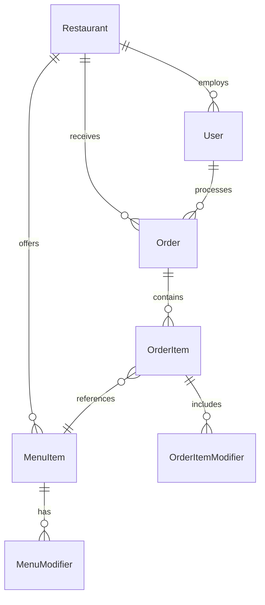

# OrderFlow 🍕 - Enterprise Restaurant Management System

> **A sophisticated, multi-tenant restaurant order management platform that solves real-world operational challenges through modern software architecture and cutting-edge technologies.**

## 🎯 **Problem Statement & Solution**

### **The Real-World Challenge**
Restaurants today face a **critical operational nightmare**: managing orders from multiple delivery platforms (UberEats, DoorDash, SkipTheDishes) while maintaining their own manual orders. This leads to:
- **Order fragmentation** across different systems
- **Lost revenue** from missed or delayed orders
- **Operational inefficiency** with staff switching between platforms
- **Customer dissatisfaction** from inconsistent order tracking

### **Our Solution**
OrderFlow provides a **unified, real-time order management system** that consolidates all order sources into a single, intuitive interface, enabling restaurants to:
- **Streamline operations** with one dashboard for all orders
- **Improve efficiency** through real-time status updates
- **Increase revenue** by reducing order processing time
- **Enhance customer experience** with consistent order tracking

---

## 🏗️ **System Architecture & Technical Design**

### **High-Level Architecture**
```
┌─────────────────┐    ┌─────────────────┐    ┌─────────────────┐
│   Frontend      │    │    Backend      │    │   Database      │
│   (React + TS)  │◄──►│ (Spring Boot)   │◄──►│  (PostgreSQL)   │
└─────────────────┘    └─────────────────┘    └─────────────────┘
         │                       │                       │
         │                       │                       │
         ▼                       ▼                       ▼
┌─────────────────┐    ┌─────────────────┐    ┌─────────────────┐
│   WebSocket     │    │   JWT Auth      │    │ Multi-tenant    │
│  Real-time      │    │   RBAC          │    │   Isolation     │
└─────────────────┘    └─────────────────┘    └─────────────────┘
```

### **Multi-Tenant Architecture**
- **Data Isolation**: Each restaurant's data is completely segregated
- **Shared Infrastructure**: Single application instance serves multiple restaurants
- **Scalability**: Horizontal scaling without data mixing
- **Security**: Tenant-level access control and data boundaries

### **Technology Stack**

#### **Frontend (Modern React Ecosystem)**
- **React 19** with TypeScript for type safety
- **Vite** for lightning-fast development and build times
- **Tailwind CSS** for utility-first, responsive design
- **React Router v6** for client-side routing
- **Axios** for HTTP client with interceptors
- **WebSocket** for real-time order updates

#### **Backend (Enterprise Java)**
- **Spring Boot 3.5.4** with Java 21
- **Spring Security** with JWT authentication
- **Spring Data JPA** with Hibernate
- **Spring WebSocket** for real-time communication
- **Maven** for dependency management
- **Lombok** for reducing boilerplate code

#### **Database & Infrastructure**
- **PostgreSQL 15** for ACID compliance and complex queries
- **Docker & Docker Compose** for containerized deployment
- **JWT** for stateless authentication
- **CORS** configuration for secure cross-origin requests

---

## 🗄️ **Database Design & Data Modeling**

### **Core Entity Relationships**


### **Key Design Patterns**
- **JPA Annotations** for object-relational mapping
- **Lazy Loading** for performance optimization
- **Cascade Operations** for data integrity
- **Audit Fields** (createdAt, updatedAt) for tracking
- **Soft Deletes** for data preservation

### **Database Schema Highlights**
```sql
-- Multi-tenant design with restaurant isolation
CREATE TABLE restaurants (
    id BIGSERIAL PRIMARY KEY,
    name VARCHAR(255) NOT NULL,
    address TEXT,
    phone VARCHAR(20),
    created_at TIMESTAMP DEFAULT CURRENT_TIMESTAMP
);

-- Complex order structure with modifiers
CREATE TABLE order_items (
    id BIGSERIAL PRIMARY KEY,
    order_id BIGINT REFERENCES orders(id),
    menu_item_id BIGINT REFERENCES menu_items(id),
    quantity INTEGER NOT NULL,
    unit_price DECIMAL(10,2) NOT NULL,
    total_price DECIMAL(10,2) NOT NULL,
    notes TEXT
);
```

---

## 🔐 **Security & Authentication Architecture**

### **JWT-Based Authentication**
- **Stateless Design**: No server-side session storage
- **Secure Token Handling**: HTTP-only cookies with CSRF protection
- **Token Refresh**: Automatic renewal for seamless user experience
- **Logout Security**: Token invalidation and cleanup

### **Role-Based Access Control (RBAC)**
```java
@PreAuthorize("hasRole('OWNER')")
public ResponseEntity<User> createUser(@RequestBody CreateUserRequest request) {
    // Only restaurant owners can create new users
}

@PreAuthorize("hasRole('OWNER') or #id == authentication.principal.id")
public ResponseEntity<User> updateUser(@PathVariable Long id, @RequestBody UpdateUserRequest request) {
    // Users can update their own profile, owners can update anyone
}
```

### **Multi-Tenant Security**
- **Data Isolation**: Users can only access their restaurant's data
- **Cross-Tenant Protection**: Prevents data leakage between restaurants
- **Audit Logging**: Track all user actions for compliance

---

## 📡 **API Design & REST Architecture**

### **RESTful Endpoint Design**
```
Authentication:
POST   /api/auth/login          - User authentication
POST   /api/auth/register       - Restaurant registration
POST   /api/auth/refresh        - Token refresh

Orders:
GET    /api/orders              - List orders with filtering
POST   /api/orders              - Create new order
PUT    /api/orders/{id}/status  - Update order status
GET    /api/orders/active       - Get active orders

Analytics:
GET    /api/analytics/daily     - Daily revenue analytics
GET    /api/analytics/items     - Top-selling items
GET    /api/analytics/revenue   - Revenue statistics

Users:
GET    /api/users               - List restaurant users
POST   /api/users               - Create new user
PUT    /api/users/{id}          - Update user
DELETE /api/users/{id}          - Delete user
```

### **API Response Standards**
```json
{
  "success": true,
  "data": { ... },
  "message": "Operation completed successfully",
  "timestamp": "2024-01-15T10:30:00Z"
}
```

### **Error Handling Strategy**
- **HTTP Status Codes**: Proper REST status code usage
- **Validation Errors**: Detailed field-level error messages
- **Global Exception Handler**: Consistent error response format
- **Logging**: Comprehensive error logging for debugging

---

## ⚡ **Performance & Scalability Features**

### **Real-Time Communication**
- **WebSocket Implementation**: Live order updates without polling
- **Event-Driven Architecture**: Reactive updates based on state changes
- **Optimistic UI Updates**: Immediate feedback for better UX

### **Database Optimization**
- **Indexed Queries**: Strategic database indexing for fast lookups
- **Lazy Loading**: On-demand data fetching to reduce memory usage
- **Connection Pooling**: Efficient database connection management
- **Query Optimization**: Analyzed and optimized SQL queries

### **Frontend Performance**
- **Code Splitting**: Lazy-loaded components for faster initial load
- **Memoization**: React.memo and useMemo for expensive computations
- **Virtual Scrolling**: Efficient rendering of large order lists
- **Responsive Images**: Optimized image loading and caching

---

## 🧪 **Testing Strategy & Quality Assurance**

### **Testing Pyramid**
```
        /\
       /  \     E2E Tests (Few)
      /____\    
     /      \   Integration Tests (Some)
    /________\  
   /          \  Unit Tests (Many)
  /____________\
```

### **Backend Testing**
- **Unit Tests**: JUnit 5 with Mockito for mocking
- **Integration Tests**: @SpringBootTest for component testing
- **Repository Tests**: @DataJpaTest for data layer testing
- **Security Tests**: @WebMvcTest for controller testing

### **Frontend Testing**
- **Component Tests**: React Testing Library for component behavior
- **Integration Tests**: User interaction testing
- **E2E Tests**: Playwright for full user journey testing
- **Accessibility Tests**: ARIA compliance and screen reader support

---

## 🚀 **Deployment & DevOps**

### **Containerization Strategy**
```dockerfile
# Multi-stage build for optimized production images
FROM node:18-alpine AS frontend-builder
WORKDIR /app
COPY package*.json ./
RUN npm ci --only=production
COPY . .
RUN npm run build

FROM nginx:alpine
COPY --from=frontend-builder /app/dist /usr/share/nginx/html
COPY nginx.conf /etc/nginx/nginx.conf
```

### **Environment Configuration**
- **12-Factor App**: Environment-based configuration
- **Secrets Management**: Secure credential handling
- **Feature Flags**: Runtime feature toggling
- **Health Checks**: Application health monitoring

### **CI/CD Pipeline**
```yaml
# GitHub Actions workflow
name: Deploy OrderFlow
on:
  push:
    branches: [main]
jobs:
  test:
    runs-on: ubuntu-latest
    steps:
      - uses: actions/checkout@v3
      - name: Run Tests
        run: |
          cd backend && ./mvnw test
          cd ../frontend && npm test
```

---

## 📊 **Analytics & Business Intelligence**

### **Real-Time Analytics Engine**
- **Revenue Tracking**: Live revenue calculations and trends
- **Order Analytics**: Volume, timing, and source analysis
- **Performance Metrics**: Kitchen efficiency and order processing times
- **Predictive Insights**: Busy hour predictions and staffing recommendations

### **Data Visualization**
- **Interactive Charts**: Chart.js for dynamic data representation
- **Real-Time Dashboards**: Live updates for operational insights
- **Export Capabilities**: CSV/PDF reports for business analysis
- **Custom Date Ranges**: Flexible time period analysis

---

## 🔮 **Future Roadmap & Scalability**

### **Phase 2: Advanced Features**
- **AI-Powered Insights**: Machine learning for demand prediction
- **Inventory Management**: Real-time stock tracking and alerts
- **Customer Relationship Management**: Loyalty programs and feedback
- **Mobile Applications**: Native iOS and Android apps

### **Phase 3: Enterprise Features**
- **Multi-Location Support**: Chain restaurant management
- **Advanced Reporting**: Executive dashboards and KPIs
- **Third-Party Integrations**: POS systems and accounting software
- **White-Label Solutions**: Customizable for different restaurant types

### **Scalability Considerations**
- **Microservices Architecture**: Breaking down into domain services
- **Event Sourcing**: CQRS pattern for complex event handling
- **Caching Layer**: Redis for session and data caching
- **Load Balancing**: Horizontal scaling across multiple instances

---

## 🎯 **Why This Project Stands Out**

### **Technical Excellence**
- **Full-Stack Mastery**: Modern frontend + enterprise backend
- **System Design**: Multi-tenant, scalable architecture
- **Security Focus**: JWT, RBAC, and data isolation
- **Performance**: Real-time updates and optimized queries

### **Problem-Solving Approach**
- **Real-World Impact**: Solves actual restaurant operational challenges
- **User-Centric Design**: Intuitive interfaces for different user roles
- **Scalable Solution**: Ready for enterprise-level deployment
- **Industry Understanding**: Deep knowledge of restaurant operations

### **Production Readiness**
- **Comprehensive Testing**: Full test coverage strategy
- **DevOps Integration**: CI/CD and containerization
- **Documentation**: API docs and deployment guides
- **Monitoring**: Health checks and performance metrics

---

## 🚀 **Quick Start**

### **Prerequisites**
- **Java 21** (for backend)
- **Node.js 18+** (for frontend)
- **PostgreSQL 15** (for database)
- **Docker & Docker Compose** (optional, for easy setup)

### **Docker Setup (Recommended)**
```bash
# Start the entire stack
docker-compose up -d

# Install frontend dependencies
cd frontend && npm install

# Start the frontend
npm run dev
```

### **Manual Setup**
```bash
# Backend
cd backend
./mvnw spring-boot:run

# Frontend
cd frontend
npm install
npm run dev
```

### **Access Points**
- **Frontend**: http://localhost:5173
- **Backend API**: http://localhost:8080/api
- **Swagger Docs**: http://localhost:8080/swagger-ui/

---

## 🤝 **Contributing**

We welcome contributions! Please see our [Contributing Guidelines](CONTRIBUTING.md) for details.

## 📄 **License**

This project is licensed under the MIT License - see the [LICENSE](LICENSE) file for details.

---

## 🏆 **Project Status**

- ✅ **Core Features**: Complete and tested
- ✅ **Authentication**: JWT + RBAC implemented
- ✅ **Real-time Updates**: WebSocket integration
- ✅ **Analytics**: Revenue and order analytics
- ✅ **User Management**: Role-based access control
- 🔄 **Testing**: Comprehensive test suite in progress
- 🔄 **Documentation**: API documentation in progress
- 🔄 **Deployment**: Production deployment guides in progress

---

**OrderFlow** - Where restaurant operations meet enterprise software engineering! 🍕✨

*Built with ❤️ using modern technologies and best practices for scalable, secure, and maintainable code.* 